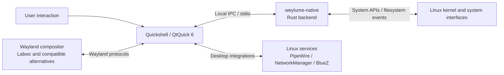

<p align="center">
  <picture>
    <source media="(prefers-color-scheme: dark)" srcset="assets/weylume-gear-darkmode.svg">
    <source media="(prefers-color-scheme: light)" srcset="assets/weylume-gear-lightmode.svg">
    
  </picture>
</p>

<h1 align="center">Weylume</h1>

<p align="center"><strong>Your compositor handles the windows. Weylume makes it a desktop.</strong></p>

<p align="center">
  A fast, full-featured Wayland desktop shell built with <strong>Quickshell, Qt 6 and Rust</strong>.
  Familiar workflows, deep system controls and a lightweight foundation, without committing to a heavyweight desktop environment.
</p>

<p align="center">
  <a href="https://github.com/deactivated0/weylume"></a>
  <a href="https://github.com/deactivated0/weylume#compatibility"></a>
  <a href="https://quickshell.outfoxxed.me/"></a>
  <a href="https://www.rust-lang.org/"></a>
  <a href="#performance"></a>
</p>

<p align="center">
  <a href="#quick-start"><strong>Get started</strong></a>
  &nbsp;&nbsp;·&nbsp;&nbsp;
  <a href="#the-experience"><strong>Explore the experience</strong></a>
  &nbsp;&nbsp;·&nbsp;&nbsp;
  <a href="#performance"><strong>See the numbers</strong></a>
  &nbsp;&nbsp;·&nbsp;&nbsp;
  <a href="#architecture"><strong>Under the hood</strong></a>
</p>

---

## A desktop shell that doesn't feel like a compromise

A bare Wayland compositor gives you control over your windows. Building the rest of a comfortable desktop usually means collecting panels, launchers, notification daemons, audio widgets, screen tools and configuration utilities yourself.

**Weylume brings those everyday essentials into one cohesive shell.**

It pairs a **QtQuick interface** with a **Rust native backend** to deliver a desktop that feels familiar, stays configurable and is designed around low-overhead system integration.

| What you get | What that means in practice |
| :--- | :--- |
| **An actual desktop** | Desktop icons, drag and drop, keyboard shortcuts, inline rename and multi-selection. |
| **A taskbar that does more** | Pinned apps, grouped windows, previews, workspace awareness and audio activity indicators. |
| **Controls where you expect them** | Wi-Fi, VPN, Bluetooth, audio devices, display controls and power profiles. |
| **A complete daily workflow** | Notifications, calendar, media controls, clipboard history, screenshots and screen recording. |
| **A native integration layer** | Rust-powered filesystem watching, system metrics and local IPC. |
| **Your machine, your apps** | An empty dock by default and an application launcher driven by installed `.desktop` entries. |

> **The idea:** Keep the freedom of a standalone Wayland compositor. Add the convenience of a desktop environment only where you need it.

## The experience

### 01. A desktop you can actually use

This isn't just a wallpaper behind a panel. Weylume gives the desktop familiar file-management behavior:

- **Select naturally:** use `Shift` for a contiguous range, `Ctrl` for individual items, or drag a selection rectangle.
- **Create and rename in place:** `Ctrl + Shift + N` creates a folder with a collision-safe name and opens inline rename; `F2` renames a selected item.
- **Move things visually:** drag items into folders or reposition icons on a collision-aware grid.
- **Find things without opening a menu:** start typing to jump to a matching desktop item.
- **Make room:** zoom desktop icons with `Ctrl + Scroll` or the keyboard.
- **Work from the keyboard:** select all, open, delete, extend selection and cancel actions with familiar shortcuts.

### 02. A taskbar built for real multitasking

Pin what matters, group running windows, switch between active instances and keep track of workspaces. Application buttons can show audio activity, and multi-monitor setups can have independent taskbars with screen-specific workspace context.

**Your first launch starts clean:** no arbitrary pinned apps, no promotional shortcuts and no hardcoded application list. Right-click an installed application to add it to the taskbar or favorites.

### 03. One control center, fewer interruptions

Weylume brings common system operations into quick, focused interfaces.

| Area | Included capabilities |
| :--- | :--- |
| **Network** | Wi-Fi discovery, connection state, NetworkManager integration and VPN controls. |
| **Bluetooth** | Device discovery, pairing flow and supported battery information. |
| **Sound** | PipeWire and WirePlumber controls, per-application streams, input/output selection and routing. |
| **Displays** | Night light, gamma-related controls and display configuration where supported. |
| **Power** | Performance, balanced and power-saving profiles through supported system services. |
| **Capture** | Screenshots, region selection and screen recording controls. |
| **System** | On-screen volume/brightness feedback, settings and authentication dialogs. |

Some controls rely on compositor protocols, system services, hardware capabilities or user permissions. Availability can differ between Linux installations.

### 04. Everything else that makes a desktop feel complete

- **Notifications:** rich content, application icons, action buttons and supported inline replies.
- **Media:** MPRIS playback controls, album art and seeking.
- **Calendar:** interactive calendar and schedule-oriented information.
- **Clipboard:** dedicated clipboard history panel.
- **Search and launch:** dynamic application discovery from locally installed desktop entries.
- **Session controls:** lock interface, Polkit authentication UI and power-related actions.
- **Customization:** settings, output-related controls, panel configuration and persistent preferences.

## Performance

### Desktop functionality without desktop-sized expectations

The project's reported example for a **Labwc + Weylume idle session** is approximately **142 MB of combined process memory**.

| Component | Reported idle memory |
| :--- | ---: |
| Labwc compositor | ~37 MB |
| Quickshell (`qs`) | ~100 MB |
| Weylume native backend (`weylume-native`) | ~5 MB |
| **Combined example** | **~142 MB** |

The original project notes also report roughly **0.0% to 0.5% idle CPU** for this setup.

**How to read these numbers:** They are project-reported example figures, not a universal benchmark or a guaranteed system-wide idle footprint. They do not include the operating system and every supporting service. Memory accounting methods, shared pages, Qt plugins, hardware, extensions, active panels and other session processes affect real results. The repository's [verification artifacts](docs/verification/) measure isolated components in other environments and should not be confused with a full-session reproduction of the 142 MB figure.

Measure your own session with:

```bash
ps -C labwc,qs,weylume-native -o pid,comm,rss,pcpu
```

`rss` is reported in KiB. Summing process RSS is useful for a quick comparison, but may double-count shared memory.

### Designed to do useful work, not repeated work

The implementation uses a Rust backend for filesystem events, local system queries and IPC instead of putting every integration into UI-side polling. The QtQuick frontend handles presentation and interaction, while compositor protocols and existing Linux services provide the underlying capabilities.

For implementation details and test limitations, see the [implementation report](docs/33_IMPLEMENTATION_REPORT.md) and [target-session acceptance checklist](docs/TARGET_ACCEPTANCE.md).

## Compatibility

**Primary target: Arch Linux with Labwc.** Other combinations are possible, but should be treated as adaptations rather than equally verified installations.

| Setup | Status | Notes |
| :--- | :--- | :--- |
| **Arch Linux + Labwc** | **Primary target** | The recommended environment and documented setup path. |
| Arch Linux + Hyprland / Sway / Wayfire | Adaptation | Features depend on available compositor protocols and integration changes. |
| Debian / Ubuntu | Adaptation | Requires distro-specific dependencies and a compatible Quickshell installation. |
| Fedora / openSUSE | Adaptation | Requires package mapping and environment-specific configuration. |
| Alpine Linux | Adaptation | Requires special attention to session management and service assumptions. |

Weylume is **a shell, not a Wayland compositor**. You still need Labwc or another compatible compositor. The [installation skill](skill.md) includes cross-distribution guidance, while [target-session acceptance](docs/TARGET_ACCEPTANCE.md) documents important checks for real hardware and sessions.

## Quick start

### Option A: AI-assisted setup

If you already use **OpenCode, Claude Code, Codex or Antigravity**, Weylume includes an installation-oriented [`skill.md`](skill.md) that documents dependencies, build steps, compositor configuration, session startup and validation.

Clone the repository, open it in your coding assistant and use:

```text
Read skill.md, inspect my Linux distribution and current Wayland session,
then install and configure Weylume using the repository's documented steps.
Preserve my existing compositor configuration, show proposed changes,
and verify the build and launch before treating the setup as complete.
```

This is a guided setup workflow, not a guarantee of one-command compatibility on every distribution. Review any proposed system or configuration changes before applying them.

### Option B: Manual setup on Arch Linux + Labwc

**1. Install the primary dependencies.**

```bash
sudo pacman -S --needed \
  git base-devel labwc rust cargo pkgconf \
  glib2 systemd-libs pipewire wireplumber networkmanager \
  bluez bluez-utils power-profiles-daemon \
  wlr-randr grim slurp wl-clipboard
```

Install Quickshell using your preferred supported packaging method. For example, with an already configured AUR helper:

```bash
paru -S --needed quickshell-git
# Alternatively: yay -S --needed quickshell-git
```

Additional UI fonts, portals, media tools or system services may be required for particular features. The complete dependency guidance lives in [`skill.md`](skill.md). The Rust backend declares a minimum supported Rust version of **1.82** in [`native/Cargo.toml`](native/Cargo.toml). The published native directory does not currently contain a `Cargo.lock`, so the build instructions do not use `--locked`.

**2. Clone the shell and compile the native backend.**

```bash
mkdir -p "$HOME/.config/quickshell"
git clone https://github.com/deactivated0/weylume.git \
  "$HOME/.config/quickshell/weylume"
cd "$HOME/.config/quickshell/weylume"

cargo build --release --manifest-path native/Cargo.toml
install -m 755 native/target/release/weylume-native ./weylume-native
```

**3. Launch from a running Wayland session.**

```bash
qs -c weylume
```

Run this inside your working Labwc session first so that any missing dependencies, display/session environment variables or QML errors are visible in the terminal.

**4. Configure automatic startup once manual launch works.**

Choose **one** startup strategy: Labwc autostart **or** a systemd user service. Do not enable two separate launchers for the same shell.

For Labwc autostart, add this line to `~/.config/labwc/autostart`:

```bash
qs -c weylume &
```

Alternatively, create `~/.config/systemd/user/quickshell-weylume.service`:

```ini
[Unit]
Description=Weylume desktop shell
PartOf=graphical-session.target
After=graphical-session.target

[Service]
Type=simple
ExecStart=/usr/bin/qs -c weylume
Restart=on-failure
RestartSec=1s

[Install]
WantedBy=graphical-session.target
```

Check `command -v qs` and adjust `ExecStart` if necessary. A systemd-launched graphical app also needs the correct Wayland and session environment exported to the user manager; see your compositor's session integration before enabling it.

```bash
systemctl --user daemon-reload
systemctl --user enable --now quickshell-weylume.service
```

**5. Validate the native backend.**

```bash
cargo test --release --manifest-path native/Cargo.toml
```

If `qmllint` and the corresponding Qt/QML modules are installed, you can additionally check QML files. Runtime validation in your actual Wayland session is still necessary.

## Keyboard-first by design

Weylume preserves interactions that experienced desktop users expect to work.

<details>
<summary><strong>Expand desktop shortcuts</strong></summary>

| Action | Shortcut |
| :--- | :--- |
| Create folder | <kbd>Ctrl</kbd> + <kbd>Shift</kbd> + <kbd>N</kbd> |
| Select range | <kbd>Shift</kbd> + click |
| Toggle an item in the selection | <kbd>Ctrl</kbd> + click |
| Rectangle selection | Drag on empty desktop space |
| Select all icons | <kbd>Ctrl</kbd> + <kbd>A</kbd> |
| Rename an item | <kbd>F2</kbd> |
| Move selection to Trash | <kbd>Delete</kbd> |
| Open selected items | <kbd>Enter</kbd> |
| Zoom icons | <kbd>Ctrl</kbd> + mouse wheel |
| Zoom icons with keyboard | <kbd>Ctrl</kbd> + <kbd>Up</kbd> / <kbd>Down</kbd> |
| Extend selection | <kbd>Shift</kbd> + arrow keys |
| Cancel or dismiss | <kbd>Escape</kbd> |
| Jump to matching icon | Start typing |

</details>

## Make it yours with IPC

Weylume exposes commands that can be bound to compositor shortcuts, launchers and personal scripts.

```bash
# Application launcher
qs -c weylume ipc call shell toggleStart

# Quick settings, audio and notifications
qs -c weylume ipc call shell toggleQuick
qs -c weylume ipc call shell toggleMixer
qs -c weylume ipc call shell toggleNotif

# Clipboard history and emoji picker
qs -c weylume ipc call shell toggleClipboard
qs -c weylume ipc call shell toggleEmoji

# Desktop operations
qs -c weylume ipc call shell createFolder

# Screenshot modes: area, active, all
qs -c weylume ipc call shell screenshot "area"

# Session lock request
qs -c weylume ipc call shell lock
```

These are **Weylume IPC commands**, not global shortcuts until they are mapped by your compositor. Session locking must be tested with a trusted, correctly configured Wayland locker before being relied upon for security or suspend protection.

## Architecture

A lightweight shell works best when each layer has a clear job.



| Layer | Responsibility |
| :--- | :--- |
| **Compositor** | Window composition, output and workspace capabilities exposed by supported protocols. |
| **Quickshell frontend** | Desktop, taskbar, menus, panels, popups, notifications and user interaction. |
| **Rust native backend** | Filesystem events, efficient metrics, integration helpers and local commands. |
| **Linux services** | Sound, connectivity, Bluetooth, authentication and other system capabilities. |

**Explore the implementation:** [`Desktop.qml`](Desktop.qml) · [`Taskbar.qml`](Taskbar.qml) · [`QuickSettings.qml`](QuickSettings.qml) · [`SettingsCenter.qml`](SettingsCenter.qml) · [`native/`](native/) · [`skill.md`](skill.md)

## Troubleshooting

<details>
<summary><strong>The shell won't launch</strong></summary>

Confirm that `qs` is on your `PATH` and launch `qs -c weylume` directly inside the graphical session. Inspect the terminal output for missing Qt modules, QML errors and session environment problems. Check that the `weylume-native` executable is present and has execute permission.

</details>

<details>
<summary><strong>The launcher doesn't show an application</strong></summary>

Weylume uses installed desktop entries. Confirm that the application exposes a valid `.desktop` file in a standard application directory, such as `/usr/share/applications` or `~/.local/share/applications`.

</details>

<details>
<summary><strong>Audio, network or Bluetooth controls are empty</strong></summary>

Verify that the relevant services are installed, active and accessible in the current user session. Audio relies on the appropriate PipeWire/WirePlumber setup; networking uses NetworkManager; Bluetooth features depend on BlueZ and supported adapters.

</details>

<details>
<summary><strong>A shortcut, display control or lock action doesn't work</strong></summary>

Weylume's IPC does not configure every compositor automatically. Check your Labwc bindings and supported Wayland protocols. For lock and suspend behavior, follow the [session-security acceptance checks](docs/TARGET_ACCEPTANCE.md) and ensure a real secure locker is correctly integrated.

</details>

<details>
<summary><strong>Weylume starts twice</strong></summary>

Check whether both Labwc autostart and a systemd user service are launching `qs -c weylume`. Keep only one startup method and restart the user session.

</details>

## Project documentation

| Resource | Why it matters |
| :--- | :--- |
| [`skill.md`](skill.md) | Installation, dependency mapping, session setup, IPC and diagnostics. |
| [`docs/TARGET_ACCEPTANCE.md`](docs/TARGET_ACCEPTANCE.md) | Real-session checks for rendering, security, input, multi-monitor behavior and reliability. |
| [`docs/33_IMPLEMENTATION_REPORT.md`](docs/33_IMPLEMENTATION_REPORT.md) | Engineering implementation notes, test coverage and known validation limits. |
| [`docs/verification/`](docs/verification/) | Stored measurements and verification artifacts. |
| [`native/Cargo.toml`](native/Cargo.toml) | Native backend dependencies, Rust version and release build configuration. |

## Contributing

Weylume is a practical project for people who care about fast, comfortable Linux desktops. Bug reports, reproducible performance measurements, compositor compatibility findings, documentation improvements and focused pull requests are valuable contributions.

Before submitting a change, run the relevant Rust tests, describe the environment you tested, and include reproduction steps or screenshots where UI behavior changes.

[Open an issue](https://github.com/deactivated0/weylume/issues) · [View pull requests](https://github.com/deactivated0/weylume/pulls) · [Browse the source](https://github.com/deactivated0/weylume)

---

<p align="center"><strong>Keep the compositor you love. Get the desktop experience you've been missing.</strong></p>

<p align="center"><a href="https://github.com/deactivated0/weylume">Explore Weylume on GitHub</a> · <a href="https://github.com/deactivated0/weylume/stargazers">Star the project</a></p>
