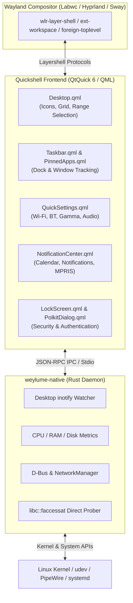

# ❄️ Weylume — High-Performance, Ultra-Lightweight Desktop Shell for Wayland

[](https://github.com/deactivated0/weylume)
[](https://quickshell.outfoxxed.me/)
[](https://www.rust-lang.org/)
[-brightgreen?logo=ram&logoColor=white)](#-resource-usage-quickshell--labwc)
[](#-resource-usage-quickshell--labwc)
[](https://github.com/deactivated0/weylume)
[](native/tests/contracts.rs)

**Weylume** is a modern, ultra-responsive desktop shell and environment for Wayland compositors (Labwc, Hyprland, Sway, Wayfire), built using **Quickshell (QtQuick / QML)** for hardware-accelerated fluid visual presentation and a dedicated **Rust** background daemon for low-latency system integration and monitoring.

Featuring Windows-like desktop ergonomics, full multi-selection workflows, quick settings, rich notifications, per-app audio mixing, and native Wayland protocols—all while maintaining an astonishingly low footprint of **~142 MB RAM** and **0.0% idle CPU**.

---

## ⚡ Resource Usage (Quickshell + Labwc)

Running **Weylume** together with the **Labwc** Wayland compositor uses only **~142 MB of RAM** and **virtually 0% CPU** at idle:

- **Labwc Compositor**: `~37 MB` RAM
- **Quickshell Shell (`qs`)**: `~100 MB` RAM
- **Rust Native Daemon (`weylume-native`)**: `~5 MB` RAM
- **Total Combined RAM**: **~142 MB** (0 B swap used)
- **Idle CPU Overhead**: **~0.0% – 0.5%**

---

## ✨ Features

### 🖥️ Interactive Wayland Desktop
- **Windows-Style Range Multi-Selection**: Hold <kbd>Shift</kbd> and click from one icon to another to select all items in between sequentially.
- **Independent Multi-Select**: Hold <kbd>Ctrl</kbd> and click to toggle selection on individual icons without losing the current selection.
- **Instant Folder Creation**: Press <kbd>Ctrl</kbd> + <kbd>Shift</kbd> + <kbd>N</kbd> on the desktop to instantly create a new folder with collision-safe unique naming (`New Folder`, `New Folder (2)`) and immediate inline rename focus.
- **Inline Renaming**: Press <kbd>F2</kbd> or click the label to rename files and folders in place.
- **Marquee / Lasso Selection**: Drag on empty desktop space to select icons with fast axis-aligned bounding box (AABB) intersection.
- **Type-Ahead Search**: Simply start typing letters on the desktop to jump directly to matching files.
- **Icon Zooming**: Zoom icons smoothly between 80% and 140% using <kbd>Ctrl</kbd> + Mouse Wheel or <kbd>Ctrl</kbd> + <kbd>↑</kbd> / <kbd>↓</kbd>.
- **Drag & Drop**: Fluidly drag files and folders into directories or rearrange them on an aligned 2D grid with collision detection.

### 🚀 Taskbar & App Dock
- **Pinning & Window Grouping**: Pin favorites, preview active instances, and switch between grouped windows.
- **Audio Stream Badges**: Indicators on taskbar buttons showing which applications are playing sound.
- **Multi-Monitor Ready**: Independent taskbars with per-screen workspace indicators and smart multi-head management.

### ⚙️ Quick Settings & Control Center
- **Network & VPN**: NetworkManager D-Bus integration for Wi-Fi scanning, connection states, and VPN authentication.
- **Bluetooth**: Device discovery, battery levels, and intuitive pairing dialog.
- **Audio Mixer**: PipeWire / WirePlumber volume controls with per-stream routing and sink/source management.
- **Night Light & Display**: Hardware gamma and color temperature adjustments with smooth transitions.
- **Power Profiles**: Toggle between Performance, Balanced, and Power Saver profiles via `power-profiles-daemon`.
- **Capture Suite**: Integrated screenshot tool and screen recorder with timer and region capture.

### 🔔 Notification Center & Calendar
- Rich notifications with action buttons, application icons, and inline reply support.
- Media player controls (MPRIS) with album artwork and playback scrubbers.
- Interactive calendar with schedule progress and $O(1)$ cached event indexing.

### 🔒 Security & System
- Integrated modern Wayland PAM lock screen.
- Built-in graphical Polkit authentication agent.
- On-Screen Display (OSD) for volume, brightness, and airplane mode changes.

---

## ⌨️ Desktop Shortcuts & Gestures

| Shortcut / Action | Description |
|---|---|
| <kbd>Ctrl</kbd> + <kbd>Shift</kbd> + <kbd>N</kbd> | **Create New Folder** on desktop with instant inline rename focus |
| <kbd>Shift</kbd> + **Click** | **Select Range** of icons between anchor and target (Windows style) |
| <kbd>Ctrl</kbd> + **Click** | **Toggle Selection** of individual icons |
| <kbd>Click + Drag</kbd> | **Marquee / Lasso** rectangular selection |
| <kbd>Ctrl</kbd> + <kbd>A</kbd> | **Select All** desktop icons |
| <kbd>F2</kbd> | **Rename** selected item in place |
| <kbd>Delete</kbd> | Move selected item(s) to **Trash** |
| <kbd>Enter</kbd> / <kbd>Return</kbd> | **Open** selected item(s) with default application |
| <kbd>Ctrl</kbd> + **Scroll Wheel** | **Zoom Icons** in or out |
| <kbd>Ctrl</kbd> + <kbd>↑</kbd> / <kbd>↓</kbd> | **Zoom Icons** larger or smaller |
| <kbd>Shift</kbd> + <kbd>↑</kbd> / <kbd>↓</kbd> / <kbd>←</kbd> / <kbd>→</kbd> | **Extend Selection** in arrow direction |
| <kbd>Escape</kbd> | Clear selection / dismiss flyout menus / cancel drag |
| Type letters | **Type-Ahead** jump to matching desktop icon |

---

## 🏗️ Architecture



---

## 📦 Installation & Setup

### Prerequisites

- **Quickshell**: `quickshell` (>= 0.3.x)
- **Rust Toolchain**: `cargo` & `rustc` (for building native backend)
- **Libraries**: `libsystemd`, `libudev`, `glib-2.0`, `gio-2.0`, `libwayland-client`, `libpipewire-0.3`
- **Compositor**: `labwc`, `hyprland`, `sway`, or `wayfire`

### 1. Clone & Build Native Core

```bash
# Clone the repository
git clone https://github.com/deactivated0/weylume.git ~/.config/quickshell/weylume
cd ~/.config/quickshell/weylume

# Build optimized release binary
cargo build --release --locked --manifest-path native/Cargo.toml
cp native/target/release/weylume-native ./weylume-native
chmod +x ./weylume-native
```

### 2. Run Tests

```bash
# Run unit and contract test suite
cargo test --release --locked --manifest-path native/Cargo.toml

# Validate QML syntax
qmllint *.qml
```

### 3. Launching Weylume

You can launch Weylume manually or through your compositor autostart:

```bash
qs -c weylume
```

### 4. Enable Systemd User Service (Recommended)

Create `~/.config/systemd/user/quickshell-weylume.service`:

```ini
[Unit]
Description=Quickshell Weylume Desktop Shell
PartOf=graphical-session.target
After=graphical-session.target

[Service]
Type=simple
ExecStart=/usr/bin/qs -c weylume
Restart=on-failure
RestartSec=1s

[Install]
WantedBy=graphical-session.target
```

Enable and start the service:

```bash
systemctl --user daemon-reload
systemctl --user enable --now quickshell-weylume.service
```

---

## 📡 IPC Command Interface

Weylume exposes a rich IPC command interface for compositor keybindings:

```bash
# Toggle Start Menu / App Launcher
qs -c weylume ipc call shell toggleStart

# Toggle Quick Settings Panel
qs -c weylume ipc call shell toggleQuick

# Toggle Audio Mixer
qs -c weylume ipc call shell toggleMixer

# Toggle Notification Center
qs -c weylume ipc call shell toggleNotif

# Toggle Clipboard History
qs -c weylume ipc call shell toggleClipboard

# Toggle Emoji Picker
qs -c weylume ipc call shell toggleEmoji

# Create New Folder on Desktop
qs -c weylume ipc call shell createFolder

# Take Screenshot ('area', 'active', or 'all')
qs -c weylume ipc call shell screenshot "area"

# Lock Screen
qs -c weylume ipc call shell lock
```

---

## 📄 License

This project is licensed under the [MIT License](LICENSE).
Built with ❤️ for the Linux desktop rice community.
